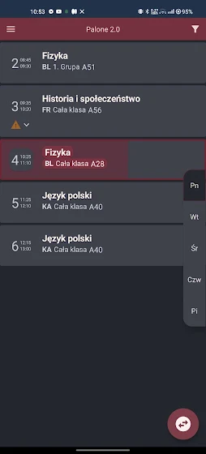
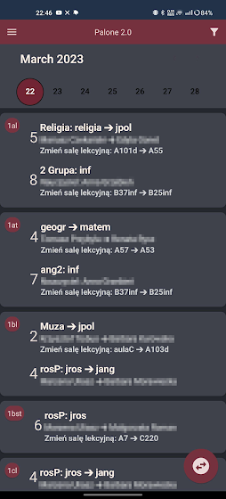

# PaloneApp 2.0

An Android app that shows my school's timetable and daily substitutions in one place, filtered to your class, teacher or room. I built it on my own in high school. It was on Google Play from 2022 to 2024 and was downloaded more than 800 times, until Google removed it after my developer account became inactive. An archived copy of the store listing is on [chrome-stats.com](https://chrome-stats.com/d/com.palone.paloneapp).

  
  

## Features

- Timetable by class, teacher or classroom, with the current lesson highlighted
- Daily substitutions, filtered to your class
- Timetable cached on the phone, so it works offline
- Hide groups that don't apply to you
- Share a substitution as an image
- Push notifications and in-app messages (Firebase Cloud Messaging)
- Custom theme editor

## How it works

The school publishes its timetable and substitutions on EduPage, which has no public API for this. I watched the requests the school's EduPage pages send in the browser's developer tools and rebuilt them in the app:

| Request | Returns |
|---|---|
| `ttviewer.js?__func=getTTViewerData` | The current timetable version (falls back to the previous year early in the school year) |
| `regulartt.js?__func=regularttGetData` | The timetable as nine linked tables: lessons, cards, subjects, teachers, classes, groups, classrooms, days and day definitions |
| `viewer.js?__func=getSubstViewerDayDataHtml` | One day's substitutions as HTML inside the JSON |

A parser joins the timetable tables into entries a student can read, and a second parser extracts substitutions from the HTML.

## Tech stack

- Kotlin, Jetpack Compose, MVVM with StateFlow and coroutines
- Retrofit, OkHttp and Gson for networking
- DataStore for settings, a local JSON file for the offline timetable
- Firebase Cloud Messaging
- JUnit and Truth for unit tests
- Min SDK 23, target SDK 35, latest version 1.52

## Building

The Firebase config is not in the repository. To build, create your own Firebase project for the package `com.palone.paloneapp`, download its `google-services.json` into `app/`, then open the project in Android Studio and run the `app` configuration. The app reads data from my school's EduPage (`elektryk.edupage.org`), so the timetable only loads while that site serves it.

## What I would do differently today

- Parse substitutions with an HTML parser such as Jsoup instead of string replacements
- Test both parsers against saved real EduPage responses
- Move logic out of ViewModels into injected use cases
- Log full HTTP bodies only in debug builds
